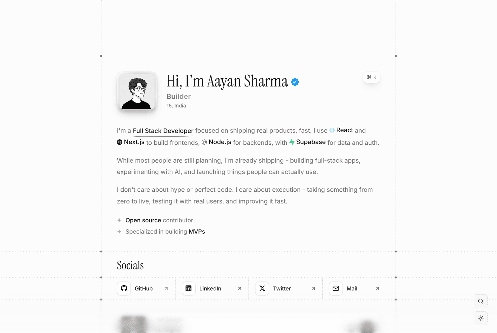
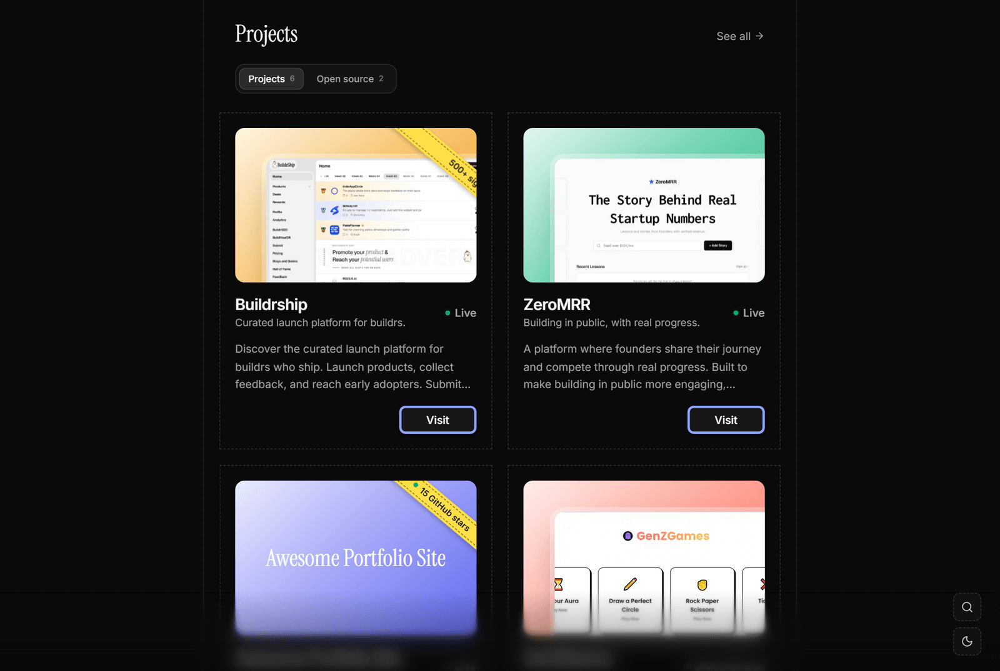

# awesome-portfolio-site

**A minimal, editorial personal portfolio: projects, experience, writings, a living collection and a public goals tracker.**

Built with Next.js 16, React 19, TypeScript, Tailwind CSS v4, Framer Motion and GSAP.

## Screenshots




## Features

- Light-first design with a dotted frame, serif headings, liquid glass details and a dark mode
- Custom cursor for mouse users, and the normal cursor everywhere else
- `⌘K` / `Ctrl K` command palette for quick navigation
- **Projects:** cards that tilt toward the mouse, a switcher for open-source work, and filters on `/projects`
- **Live numbers:** ribbons on project cards can show GitHub stars, YouTube subscribers or domain rating, refreshed hourly
- **Experience:** expandable rows with company logos
- **GitHub activity:** a contribution graph whose dots turn green on hover
- **Writings:** MDX posts with reading time and RSS (`/rss.xml`), plus an editor for writing posts on the site
- **Collection:** a bookshelf, music with previews, a poster wall for movies and shows, and a wishlist
- **Goals:** public goals with progress. Only the owner (password) can edit them
- A unique-visitor counter
- SEO foundation: metadata, Open Graph, Twitter cards, JSON-LD, robots, sitemap and manifest
- Works on phones, and respects `prefers-reduced-motion`

## Quick start

```bash
npm install
cp .env.example .env.local   # optional
npm run dev
```

Open <http://localhost:3000>.

## Make it yours

Everything personal lives in a few files, and most of the rest is reusable.

| What                       | Where                                                                    |
| -------------------------- | ------------------------------------------------------------------------ |
| Name, links, location, SEO | `src/lib/site.ts`                                                        |
| Bio, skills, thoughts      | `src/app/page.tsx`                                                       |
| Experience                 | `src/data/experience.ts` (logos go in `public/assets/logos`)             |
| Projects                   | `src/data/projects.ts` (screenshots go in `public/assets`)               |
| Collection                 | `src/data/collection.ts`                                                 |
| Writings                   | `content/writings/*.mdx`, or `/writings/new` after signing in            |
| Goals                      | Edit live on `/goal` after signing in with your password                 |
| Photo and ID badge         | `public/assets/profile.jpg`, `lanyard-front.png`, `lanyard-back.png`     |

Delete the sample post in `content/writings`, and replace the personal images in `public/assets`.

### Project card options

Each entry in `src/data/projects.ts` can also set:

| Field        | What it does                                                                                    |
| ------------ | ----------------------------------------------------------------------------------------------- |
| `accent`     | The colour of the card's gradient                                                               |
| `tagline`    | The short line under the title                                                                  |
| `shot`       | Crops the screenshot to the app window, in percent of the image: `{ x, y, w }`                  |
| `badge`      | Fixed ribbon text. Please keep it real                                                          |
| `live`       | A live ribbon number: `"github-stars"`, `"youtube-subscribers"` or `"domain-rating"`            |
| `moreBadges` | More ribbon text. With more than one item, the ribbon scrolls through them                      |

Set `status: "Discontinued"` when a project's site is gone. The card drops its Visit button and links to the code instead.

## Environment variables

All optional, see [.env.example](./.env.example).

| Variable                                    | Purpose                                                        |
| ------------------------------------------- | -------------------------------------------------------------- |
| `NEXT_PUBLIC_SITE_URL`                      | Canonical URL for SEO, sitemap and RSS                         |
| `ADMIN_PASSWORD`                            | Unlocks `/goal` and `/writings/new`. Without it both are locked |
| `SUPABASE_URL`, `SUPABASE_SERVICE_ROLE_KEY` | Persistent storage for goals, posts and the visitor counter    |
| `GITHUB_TOKEN`                              | Raises the GitHub API rate limit. Needs no scopes              |
| `TMDB_API_KEY`                              | Sharper movie posters                                          |

To use Supabase, run [`supabase/schema.sql`](./supabase/schema.sql) once in your project's SQL editor. The tables have Row Level Security enabled with no public policies, so only the server can read or write them, using the service-role key. Never expose that key to the browser.

Without Supabase, data is stored in `./data/*.json`. That works locally but **does not persist on serverless hosts** such as Vercel or Netlify, so set up Supabase before deploying if you use goals, posts written on the site or the visitor counter.

## Scripts

- `npm run dev` starts the dev server
- `npm run build` creates a production build
- `npm run start` runs the production build
- `npm run lint` runs ESLint

## Design

[DESIGN.md](./DESIGN.md) covers the colours, type, layout, motion and rules. Read it before changing the UI.

## Contributing

PRs are welcome. Read [CONTRIBUTING.md](./CONTRIBUTING.md) first.

## License

The code is MIT, see [LICENSE](./LICENSE). This does not cover personal content or third-party artwork, such as the profile photo, book covers and posters. Replace those with your own in a fork.
